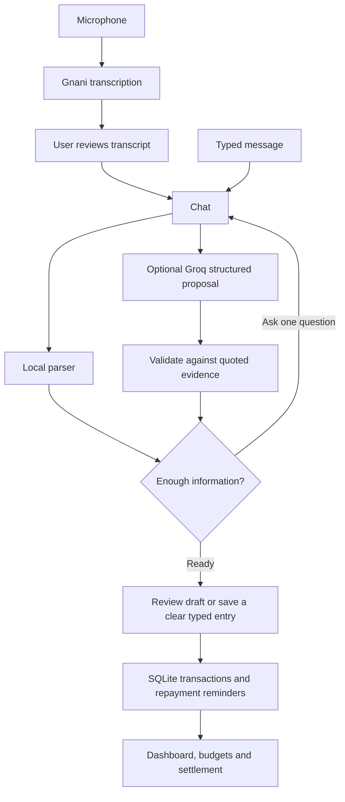

# Enma · When should an expense assistant ask before saving?

Enma turns spoken or typed English, Hindi and Hinglish into a ledger. Its central decision is whether the words establish that money changed hands. “I paid Aditya ₹350” records spending. “Aditya owes me ₹350” creates a reminder to collect. A later repayment changes the ledger when the user marks it received.

## Architecture



The local parser handles corrections, quantities, dates and debt direction. The optional model reads the active exchange. Its validator checks source phrases, amount, direction, dates, counterparties and linked repayments. The save operation writes related expenses and reminders together. The public demo uses a temporary ledger per browser session.

## Evaluation design

The dataset contains 40 development examples and 10 previously reviewed examples. It includes split bills, mixed income and expenses, refunds, self-correction and incomplete speech. For each case, the evaluator compares the initial action and the final proposed ledger after at most one scripted reply. Ledger scoring checks amount, direction, category, date, person and the linked transaction position. The question score checks the kind of detail requested. No benchmark proposal is saved.

Three conditions use the same inputs: the local parser, the structured Groq proposal, and that proposal after Enma validates it. Identical dialogue turns reuse the same provider response within each run. A rejected proposal counts as unresolved. When Groq is unavailable in the real app on an initial turn, Chat falls back to local parsing. The benchmark keeps that fallback separate so the model's contribution stays visible. Wrong drafts measure proposals offered for review, not money actually saved.

## Scripted mobile demonstration

[Watch the mobile workflow](mobile-demo.gif). Chrome ran in a 390 × 844 touch viewport with an isolated demo ledger. A synthesized voice said “I paid five hundred rupees for lunch.” Gnani returned “I paid 500 rupees for lunch.” The script reviewed the transcript, checked the draft, changed the lunch amount to ₹450 and saved it. It then saved a ₹350 receivable from Aditya, found it on the dashboard, marked it received, undid settlement, and undid the reminder save. The amount to collect returned to ₹0. The captured steps fit the viewport without horizontal scrolling.

This exercises real microphone controls and a live transcription request using a known audio file. Physical handset permissions, noisy rooms, regional accents and unassisted human task completion remain part of the natural-speaker study.

## Reproduce

Run from the repository root after installing the dependencies. The model comparison requires a configured Groq key.

```bash
python -m unittest discover -s tests
python -m benchmarks.enma_understanding --split dev --model --request-interval 8 --retry-rate-limits --verbose
python -m benchmarks.enma_understanding --split holdout --model --request-interval 8 --retry-rate-limits --verbose
ENMA_DEMO_MODE=1 streamlit run app.py
```

## Results · 20 November 2026

All 54 automated tests passed. The table shows exact draft matches after at most one reply, plus incorrect initial drafts offered for review. Each denominator includes every assigned case. Provider outages and validation rejections appear separately.

| Split | Method | Correct first action | Exact final draft | Wrong initial drafts | Service unavailable | Draft rejected |
|---|---|---:|---:|---:|---:|---:|
| dev | Local | 40/40 | 40/40 | 0 | 0 | 0 |
| dev | Groq | 15/40 | 16/40 | 21 | 2 | 0 |
| dev | Groq + validation | 8/40 | 7/40 | 0 | 2 | 31 |
| holdout | Local | 10/10 | 10/10 | 0 | 0 | 0 |
| holdout | Groq | 5/10 | 3/10 | 5 | 0 | 0 |
| holdout | Groq + validation | 1/10 | 0/10 | 0 | 0 | 10 |

Each split reused the same Groq proposals before and after validation. The model was `openai/gpt-oss-20b`. The paced run allowed short rate-limit cooldowns. Timing in the logs includes waits for the first pass and cached responses for the validation pass, so it cannot serve as a model latency comparison.

### What went wrong

- On the reviewed ten cases, the model classified an unspecified payment from a cousin as a gift. The user only established that money arrived.
- The model assigned today's date to a debt with no stated due date. The validator rejected the unsupported date, so the user would need another turn.
- The validator also rejected correctable multi-event drafts when it could not verify a quoted span. A low wrong-draft count must be read together with completion rate.

The local parser has been tuned against these 50 examples. Its 50 exact matches establish regression coverage. They do not estimate accuracy for new speakers or establish that rules generally outperform the model.

### Paired speech checks

The following clips used synthesized voices and a live Gnani request. Reference transcripts use digits for spoken amounts. Both columns use the local parser. A question in a column means the parser could not produce a final draft on that turn.

| Language | Gnani transcript | Draft from Gnani transcript | Draft from reference |
|---|---|---|---|
| English | I paid 500 rupees for lunch. | debit ₹500 Food & Dining | debit ₹500 Food & Dining |
| Hindi | मुझे आदित्य से 350 रुपये लेने हैं। | collect ₹350 आदित्य | collect ₹350 आदित्य |
| Hinglish | मैंने मूवी के लिए 3,000 रुपये पे किए। | debit ₹3000 Other | debit ₹3000 Entertainment |

The Hinglish difference came from the parser's vocabulary. Gnani preserved the movie and amount, spelling “movie” as “मूवी”. After the recorded comparison we added this spelling and replayed the exact transcript. It produced a ₹3,000 Entertainment expense. The regression suite now includes this case.
